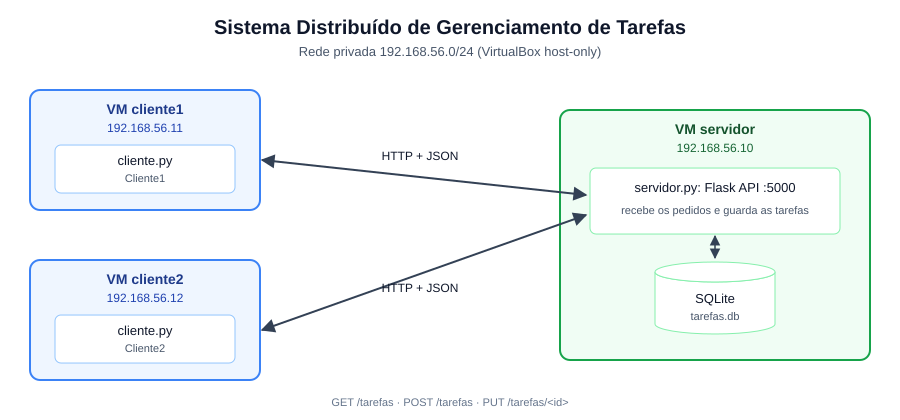
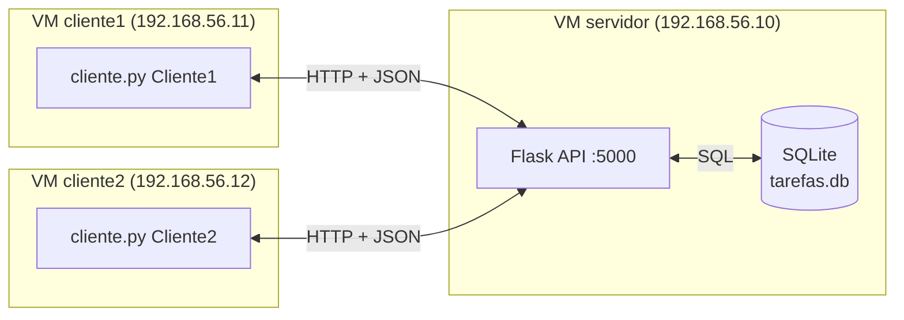
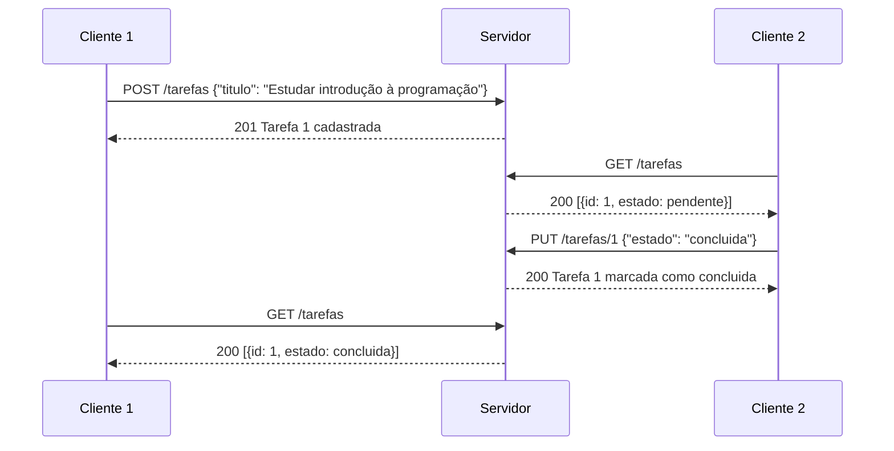

# Arquitetura

## Componentes

| Componente | Onde roda | Responsabilidade |
|------------|-----------|------------------|
| **Servidor** (`servidor/servidor.py`) | VM `servidor` | Abre o serviço HTTP na porta 5000, recebe os pedidos, grava e lê as tarefas no SQLite e responde em JSON. É o único lugar onde os dados ficam guardados. |
| **Banco** (`tarefas.db`) | VM `servidor` | Tabela `tarefas` com `id`, `titulo` e `estado` (`pendente` ou `concluida`). |
| **Cliente 1 e Cliente 2** (`cliente/cliente.py`) | VMs `cliente1` e `cliente2` | Menu de terminal. Não guardam dados: tudo o que mostram vem do servidor. |

## Comunicação

- Protocolo: HTTP sobre TCP, com corpo em JSON.
- `GET /tarefas` lista, `POST /tarefas` cadastra e `PUT /tarefas/<id>` altera o estado.
- Sucesso: resposta com `mensagem`. Erro: resposta com `erro` e código 400 ou 404.
- Se o servidor não responder em 5 segundos, o cliente mostra "Servidor indisponível" e continua funcionando.

## Fluxo do exemplo do enunciado

