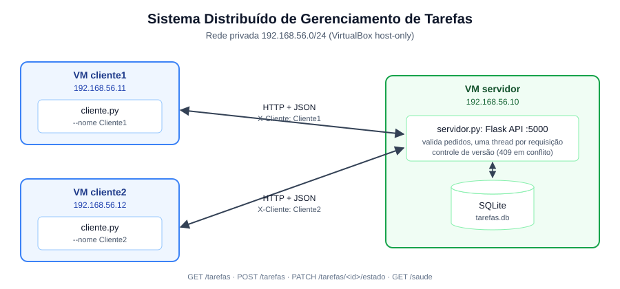
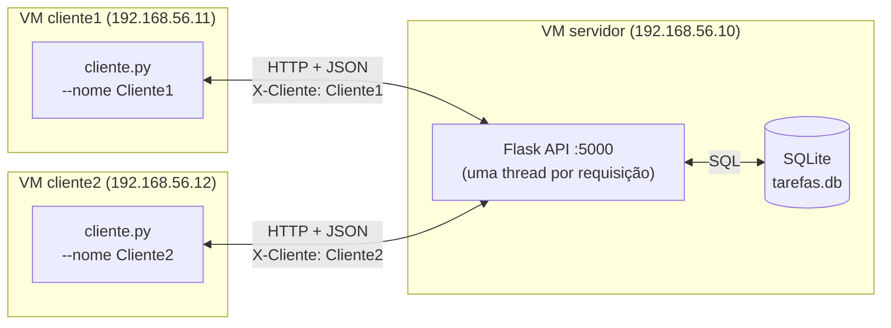
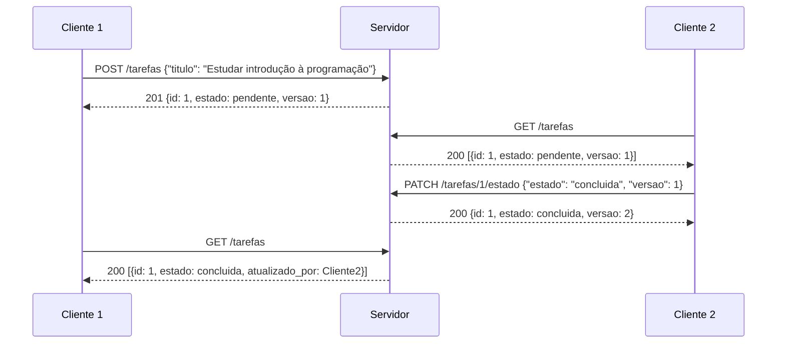

# Arquitetura

## Componentes

| Componente | Onde roda | Responsabilidade |
|------------|-----------|------------------|
| **Servidor** (`servidor/servidor.py`) | VM `servidor` | Abre o serviço HTTP na porta 5000, valida os pedidos, grava e lê as tarefas no SQLite e responde com JSON padronizado. É o único dono dos dados. |
| **Banco** (`tarefas.db`) | VM `servidor` | Tabela `tarefas` com id, título, descrição, estado, quem criou, quem alterou por último, horários e `versao`. |
| **Cliente 1 e Cliente 2** (`cliente/cliente.py`) | VMs `cliente1` e `cliente2` | Interface de terminal. Não guardam dados próprios: toda tela mostrada vem de uma resposta do servidor. |

## Comunicação

- Protocolo: HTTP/1.1 sobre TCP, com corpo em JSON (UTF-8).
- Cada cliente se identifica no cabeçalho `X-Cliente`, que o servidor grava em `criado_por` e `atualizado_por`.
- Formato de resposta: `{"sucesso": true|false, "mensagem": "...", "dados": ...}`.
- Códigos usados: `200` (ok), `201` (criado), `400` (dados inválidos), `404` (não encontrado), `409` (conflito de versão) e `500` (erro interno).

## Fluxo do exemplo do enunciado

## Consistência e concorrência

- O servidor é multithread. Cada requisição usa sua própria conexão SQLite, e o SQLite serializa as escritas.
- A alteração de estado roda numa transação `BEGIN IMMEDIATE`, que lê a versão e atualiza a tarefa sem interferência de outro cliente.
- **Controle de concorrência otimista:** o cliente envia a `versao` que viu na última listagem. Se outro cliente alterou a tarefa nesse meio-tempo, o servidor responde `409` em vez de sobrescrever às cegas.
